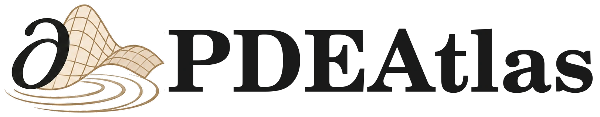

<h1 align="center">
  <picture>
    <source media="(prefers-color-scheme: dark)" srcset="Blueprint/Assets/Brand/logo-dark.webp">
    
  </picture>
  <br>
  Partial differential equations in Lean
</h1>

PDEAtlas is a library of partial differential equations in Lean 4 and Mathlib. It follows Lawrence C.
Evans's *Partial Differential Equations*, second edition, and has modules for every section of
chapters 2 to 12 of the book: the four linear equations, first-order equations, Sobolev spaces,
elliptic and evolution equations, the calculus of variations, Hamilton–Jacobi equations,
conservation laws and nonlinear waves. Beyond the book it covers incompressible fluid mechanics. It
has about 1.08 million lines of Lean and 36,000 theorems.

* [Blueprint](https://robertboy18.github.io/PDEAtlas/): the book that goes with the library, with
  statements, proof ideas, worked examples and figures linked to the Lean declarations, and a map of
  which sections of Evans each statement formalizes
* [BlowupZoo](https://github.com/Robertboy18/BlowupZoo): finite-time blowup and nonuniqueness
  theorems for fluid equations, built on PDEAtlas
* [SymLean](https://github.com/Robertboy18/SymLean): the computer algebra system PDEAtlas computes with

I wanted PDE work in Lean to start from the theorems a graduate course proves, each stated with all
of its hypotheses, and not from general analysis alone. So we built PDEAtlas. We contacted Evans
about following his book, and he was excited about the project.

## What we focus on

1. **Formalization that can go upstream.** We hold every result to the standard of
   [Mathlib](https://leanprover-community.github.io/contribute/index.html), so that the general ones
   can move there or to [Tau Ceti](https://github.com/TauCetiProject/TauCeti), a library downstream
   of Mathlib incubated by the Lean FRO and the Mathlib Initiative. We coordinate with Tau Ceti's
   [PDE roadmap](https://github.com/TauCetiProject/TauCetiRoadmap/blob/main/TauCetiRoadmap/PDE/README.md).
   The [standards](#standards) are listed below.
2. **Graduate courses.** The library follows Evans chapter by chapter, so a student can read a
   section of the book next to its Lean statements, and the module docs cite the theorems they
   formalize. We state theorems as faithfully as we can, and where the proof allows, more generally
   than the book. Three examples:
   - smooth functions are dense in every Sobolev space W^{k,p}(U), 1 ≤ p < ∞, on every open set U
     (Meyers and Serrin; Evans §5.3.2, Theorem 2, proves it for bounded U), in
     [`OpenDomain.lean`](PDE/Spaces/Sobolev/Approximation/Density/OpenDomain.lean);
   - weak solutions of second-order parabolic equations exist (§7.1.2, Theorems 3 and 4) without the
     symmetry aⁱʲ = aʲⁱ that Evans assumes, in
     [`MeasurableExistence.lean`](PDE/Parabolic/Heat/Variational/MeasurableExistence.lean);
   - Kaplan's lifespan bound for u_t − Δu = u² (§9.4.1, Theorem 1) holds in every bounded open set,
     with nothing assumed about its boundary, in
     [`DirichletBlowup.lean`](PDE/Parabolic/Heat/Nonlinear/DirichletBlowup.lean).
3. **Computation with SymLean.** Calculations run through [SymLean](https://github.com/Robertboy18/SymLean),
   our verified computer algebra system for Lean, which works like Mathematica or SymPy but returns
   proofs. PDEAtlas extends its `cas` and `cega` tactics to its PDE operators and adds a `#cas` PDE
   solver. Every answer comes with a theorem the kernel has checked.
4. **Research and exposition.** We want the library to help mathematicians: as foundations for new
   results, and as an account of the theory they can read. The blowup and nonuniqueness theorems in
   [BlowupZoo](https://github.com/Robertboy18/BlowupZoo) are built on PDEAtlas, and the Blueprint
   explains the mathematics behind each part of the library.

## Example

```lean
import PDE

#cas [pdesolve u t x, u 0 x = sin x + 3 * sin (2 * x), u t 0 = 0, u t pi = 0] (u_t = 2 * u_xx)
-- u(t, x) = Real.exp (-(2 * t)) * Real.sin x + 3 * Real.exp (-(8 * t)) * Real.sin (2 * x)
```

This is the heat equation u_t = 2 u_xx on [0, π], with u = 0 at both ends and u = sin x + 3 sin 2x
at time 0. Under "More details" the report prints the theorem behind the answer, which the kernel
has checked: the formula solves the problem, and by the energy method every C² solution equals it
for t ≥ 0. The same command solves transport and wave equations. It refuses data that are not
finite sine sums, such as x² on [0, π], because their solution is an infinite series.

In a proof, the `cas` tactic does the same calculations:

```lean
example (p : ℝ^3) (hp : 0 < p 0 ^ 2 + p 1 ^ 2 + p 2 ^ 2) :
    PDE.laplacian (fun q : ℝ^3 ↦ 1 / Real.sqrt (q 0 ^ 2 + q 1 ^ 2 + q 2 ^ 2)) p = 0 := by
  cas
```

## What is in it

| Evans | Topics | Where |
| --- | --- | --- |
| Ch. 2 | Transport, Laplace's, heat and wave equations | [`Hyperbolic/Transport`](PDE/Hyperbolic/Transport), [`Elliptic/PotentialTheory`](PDE/Elliptic/PotentialTheory), [`Parabolic/Heat`](PDE/Parabolic/Heat), [`Hyperbolic/Classical`](PDE/Hyperbolic/Classical) |
| Ch. 3 | Complete integrals, characteristics, Hamilton–Jacobi equations, conservation laws | [`Hyperbolic/FirstOrder`](PDE/Hyperbolic/FirstOrder), [`Hyperbolic/HamiltonJacobi`](PDE/Hyperbolic/HamiltonJacobi), [`Hyperbolic/ConservationLaw`](PDE/Hyperbolic/ConservationLaw) |
| Ch. 4 | Separation of variables, similarity solutions, transforms, asymptotics, power series and Cauchy–Kovalevskaya | [`Representations`](PDE/Representations), [`Cauchy`](PDE/Cauchy) |
| Ch. 5 | Hölder and Sobolev spaces, approximation, extension, traces, Sobolev inequalities, compactness | [`Spaces`](PDE/Spaces) |
| Ch. 6 | Weak solutions, regularity, maximum principles, eigenvalues | [`Elliptic`](PDE/Elliptic) |
| Ch. 7 | Parabolic and hyperbolic equations, first-order hyperbolic systems, semigroups | [`Parabolic`](PDE/Parabolic), [`Hyperbolic`](PDE/Hyperbolic), [`Analysis/Evolution`](PDE/Analysis/Evolution) |
| Ch. 8 | Minimizers, regularity, constraints, critical points, Noether's theorem | [`CalculusOfVariations`](PDE/CalculusOfVariations) |
| Ch. 9 | Monotonicity, fixed points, sub- and supersolutions, nonexistence, gradient flows | [`Elliptic/Monotone`](PDE/Elliptic/Monotone), [`Elliptic/Semilinear`](PDE/Elliptic/Semilinear), [`Analysis/Evolution/GradientFlow`](PDE/Analysis/Evolution/GradientFlow) |
| Ch. 10 | Viscosity solutions, uniqueness, optimal control | [`Hyperbolic/HamiltonJacobi`](PDE/Hyperbolic/HamiltonJacobi) |
| Ch. 11 | Riemann's problem, systems of two conservation laws, entropy criteria | [`Hyperbolic/ConservationLaw`](PDE/Hyperbolic/ConservationLaw) |
| Ch. 12 | Energy, semilinear and critical-power waves, nonexistence | [`Hyperbolic/NonlinearWave`](PDE/Hyperbolic/NonlinearWave) |
| Beyond | Stokes, Euler, Navier–Stokes, Boussinesq, axisymmetric Euler, the De Gregorio model | [`Fluid`](PDE/Fluid) |

We formalize selected theorems of each section, not every one, and each module doc says where its
statements differ from the book. [`PDE/Examples`](PDE/Examples) holds compiled examples, which no
library module imports.

## Standards

- Lean's kernel checks every proof. No proof uses `sorry`, and every declaration in the library
  rests only on Lean's three standard axioms, `propext`, `Classical.choice` and `Quot.sound`: we
  checked all 99,811 of them, the examples included.
- The library builds with Mathlib's standard set of linters, and warnings are errors.
- Every theorem states all of its hypotheses, regularity included. This matters in Lean, where
  `fderiv` is zero at points where a function is not differentiable, so an equation written with
  derivatives is the classical PDE only together with the regularity hypotheses our solution
  classes carry.
- Every one of the 6,329 library modules starts with a doc that says what it proves and where its
  statements differ from their source, and 1,831 of them have a References section that cites the
  results they formalize.
- By default the kernel also checks the numerical certificates, instead of trusting compiled code.

## Using PDEAtlas

PDEAtlas builds with Lean v4.35.0 and Mathlib v4.35.0. Add it to your `lakefile.lean`:

```lean
require LeanPDE from git "https://github.com/Robertboy18/PDEAtlas.git" @ "main"
```

The package is still called `LeanPDE` and its modules live under `PDE`. Run `lake update LeanPDE`
and `lake exe cache get`; SymLean and FloatLib come along. Then start a file with `import PDE`, or
import a single module for a smaller load.

## Related projects

- Soto Franco and Marshall-Stevens's [EllipticPDE](https://github.com/alejandro-soto-franco/EllipticPDE)
  formalizes linear divergence-form Dirichlet theory, overlapping our variational and regularity layers.
- Armstrong and Kempe formalized De Giorgi–Nash–Moser theory in Lean for uniformly elliptic
  equations with bounded measurable coefficients ([arXiv:2604.05984](https://arxiv.org/abs/2604.05984)).
- Tomoki Uda's [leray-hopf](https://github.com/uda-lab/leray-hopf) formalizes global weak solutions
  of the unforced Navier–Stokes equations on the three-dimensional torus and on ℝ³.

The Blueprint's [Related Work chapter](Blueprint/Chapters/RelatedWork.lean) covers more, including
computer algebra and verified numerics.

## Citation, license and acknowledgements

Our textbook reference is Lawrence C. Evans, *Partial Differential Equations*, second edition,
Graduate Studies in Mathematics **19**, American Mathematical Society, 2010, ISBN 978-0-8218-4974-3
([AMS record](https://www.ams.org/bookpages/gsm-19-r)). The release metadata is in
[formalization.yaml](formalization.yaml), and [CONTRIBUTING.md](CONTRIBUTING.md) says how to contribute.

PDEAtlas is written at Caltech by Robert Joseph George and Anima Anandkumar, with the PDE group of
Thomas Y. Hou. Contributors include Peicong Song. It is released under the [Apache License 2.0](LICENSE).

Everything here starts from [Mathlib](https://github.com/leanprover-community/mathlib4). The
Blueprint is written with [Verso](https://github.com/leanprover/verso),
[VersoBlueprint](https://github.com/leanprover/verso-blueprint) and
[SubVerso](https://github.com/leanprover/subverso).
